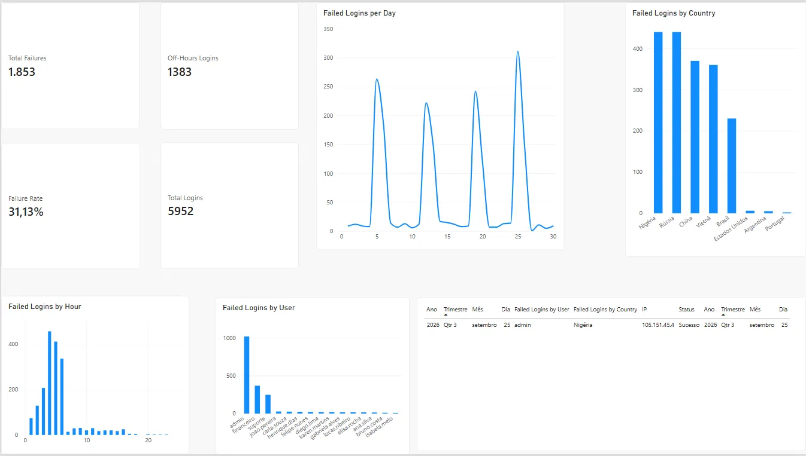

# Suspicious Login Analysis (Power BI)

A security-themed Power BI dashboard that analyzes one month of simulated login data to detect brute-force attacks and a compromised account.

> The dataset is **fictional**, generated for learning purposes. No real users, IPs or systems are involved.

## Dataset

About 5,950 login events from September 2026, with the columns: Timestamp, User, Country, IP address, Status (Success/Failure) and Application.

## What I did

- Imported and cleaned the data with Power Query (split date and hour, and fixed the IP column type so addresses keep their dots)
- Built DAX measures: Total Logins, Total Failures, Failure Rate and Off-Hours Logins (10 PM to 6 AM)
- Built visuals: failed logins per day, by country, by hour and by user
- Investigated the data with filters until I found the compromised account

## Key findings

- **Attacks come in waves.** Failure spikes appear on Sep 5, 12, 19 and 25, almost exactly one week apart.
- **Attacks happen at night.** Failures concentrate in the early morning hours, while normal logins happen during business hours.
- **Generic accounts are targeted.** `admin`, `financeiro` and `suporte` receive most of the failures. Personal accounts are barely touched.
- **High volume does not mean attack.** Brazil has many failures simply because it has most of the normal traffic. Nigeria, Russia, China and Vietnam stand out because their failures are almost entirely malicious.

## Incident: compromised admin account

On Sep 25, IP `105.151.45.4` (Nigeria) made 300 failed login attempts against `admin` between 04:00 and 07:00. At 07:12 the same IP logged in successfully through the VPN.

This pattern (many failures followed by a success from the same IP) suggests a successful brute-force attack, and the account should be treated as compromised. The attacker then kept going: on Sep 26 a different Nigerian IP targeted the `financeiro` account.

## Recommendations

- Lock accounts after a few failed attempts
- Enforce multi-factor authentication (MFA), especially for admin and VPN
- Alert on many failures from one IP and on logins from unusual countries
- On detection: reset the password, block the IP and review the session

## What I learned

Data cleaning with Power Query, writing DAX measures, building a dashboard from raw data, and reading logs like a security analyst, including how a brute-force attack looks in login data.

## Files

- `dashboard.pbix`: the Power BI report
- `logins_fake_setembro_2026.csv`: the fictional dataset
- `dashboard.png`: screenshot of the report
